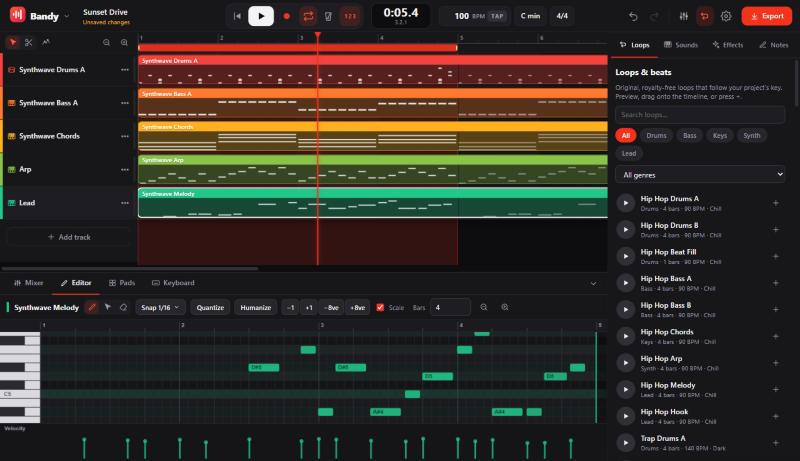

# Bandy

**A free, open-source music studio that runs entirely in your browser.**
Multitrack recording, MIDI editing, 22 synths, drum kits, a sampler, 16 effects with 40+ presets, a loop library, mixing, automation, mastering and WAV / stem / MIDI export — no account, no server, no install, no build step.



Bandy's interface and workflow are inspired by browser-based studios such as BandLab (dark studio layout, track headers with mute/solo/arm, a bar ruler with loop strip, a loops & sounds panel, a bottom dock with mixer and editors). It is an independent project, **not affiliated with or endorsed by BandLab**, and contains no BandLab code, assets or sounds.

## Run it

Bandy is a static site made of plain ES modules — there is nothing to build.

```bash
git clone https://github.com/ahpah-dev/bandy.git
cd bandy
python tools/serve.py        # or: npx serve .
# open http://127.0.0.1:5173
```

ES modules and AudioWorklets need `http://` (not `file://`), so use any static server. A modern Chromium, Firefox or Safari is required. Chrome/Edge give the best results (Web MIDI, low-latency audio).

## Features

| Area | What you get |
| --- | --- |
| **Tracks** | Voice/Mic, Guitar (amp sim), Bass, Instrument (synth), Drums, Sampler and imported Audio tracks · rename, recolour, reorder, duplicate, resize, mute / solo / arm / input monitoring |
| **Arrangement** | Bar ruler, snap grid, zoom, drag / trim / split / duplicate / copy-paste regions, loop handle, fades, region mute, marquee select, drag-and-drop audio files and loops, split tool, loop-region strip |
| **Recording** | Microphone / audio-interface recording with count-in, input monitoring, device picker and latency compensation · MIDI recording from the on-screen keyboard, computer keyboard ("musical typing") and Web MIDI devices |
| **MIDI editor** | Piano roll and drum grid with draw / select / erase tools, velocity lane, snap, quantise, humanise, transpose, scale highlighting, copy / paste / duplicate, live preview |
| **Sounds** | 22 synth instruments (keys, pads, leads, basses), 5 drum kits (808, acoustic, trap, lo-fi, house), 16-pad sampler (load or record your own samples) |
| **Loops** | 110+ original, royalty-free generated loops across 13 genres that follow the project key — preview, drag to the timeline, or click + |
| **Effects** | EQ, compressor, reverb, delay (tempo-synced), distortion, amp sim, chorus, flanger, phaser, filter / auto-wah, tremolo, bitcrusher, stereo width, noise gate, pitch shift, **Auto-Pitch** (real-time retune to a key/scale) · 40+ presets (vocal, guitar, bass, drums, synth, creative) · save your own presets |
| **Mixer & mastering** | Channel strips with faders, pan, meters and inserts · master fader · one-click mastering presets (Universal, Tape, Punchy, Clarity, Warm, Loud) with limiter and soft clipper |
| **Audio editing** | Sample editor with trim handles, gain, pitch shift, time-stretch (WSOLA, pitch-independent), reverse, fades, normalise, fit-to-tempo, bounce to WAV · experimental stem splitter (bass / vocals-centre / instruments-sides / highs) |
| **Automation** | Volume and pan automation lanes with draggable breakpoints |
| **Project** | Tempo (with tap), key & scale, time signature, undo / redo (120 steps), lyrics & notes, light / dark theme, auto-save to your browser (IndexedDB), reopen projects, shareable `.bandy` project files |
| **Export** | 16/24/32-bit WAV mixdown · loop range only · normalise · per-track stems (`.zip`) · standard MIDI file · full project file |
| **Extras** | Tuner, keyboard shortcuts (press `?`), metronome with accented downbeats |

### What Bandy does *not* have

Bandy is a local-first app, so BandLab's cloud features are intentionally out of scope: accounts, social feed, publishing, real-time collaboration and cloud sync. The stem splitter is a lightweight DSP tool, not AI source separation, and there is no MP3 encoder (export WAV and convert with any tool). Loops and instruments are synthesised by code rather than recorded samples, so they sound "synthetic" by design — and are free of any licensing worries.

## Keyboard shortcuts

`Space` play/pause · `R` record · `L` loop · `K` metronome · `S` split at playhead · `Ctrl+Z / Shift+Z` undo/redo · `Ctrl+C / X / V / D` copy / cut / paste / duplicate · `Del` delete · `T` add track · `M` mute · `A` arm · `F` zoom to fit · `+ / −` zoom · `Enter` open editor · `?` full list.
In the Keyboard tab, **musical typing** maps `A W S E D F T G Y H U J K` to piano keys (`Z / X` change octave).

## Project layout

```
index.html            app shell
css/styles.css        theme (dark + light)
js/main.js            bootstrap, layout, shortcuts
js/state.js           project model, selection, undo/redo, region editing
js/storage.js, zip.js IndexedDB persistence, .bandy (zip) import/export
js/audio/             engine (graph + scheduler), synth, effects, loops, DSP,
                      recording, offline render / MIDI export, AudioWorklets
js/ui/                topbar, timeline, piano roll, mixer, sidebar, editors, dialogs
tools/serve.py        no-cache static dev server
tests/index.html      in-browser smoke tests (effects, presets, instruments, loops, DSP)
```

Run the smoke tests by serving the repo and opening `/tests/`.

## Contributing

Issues and pull requests are welcome. There is no framework or bundler — keep modules small and dependency-free. Ideas that would be great additions: MP3/OGG export, a looper pad instrument, tempo maps, richer audio clip editing, MIDI import, plugin-style effect UIs.

## License

Public domain under [The Unlicense](LICENSE). Do whatever you like with it.
